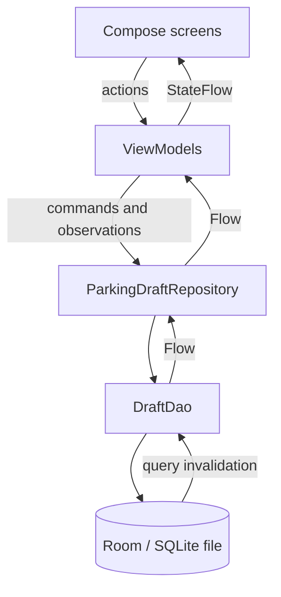

# Week 8 implementation guide

This guide explains the actual local prototype. Read [the milestone](week8.md) for requirements and demonstration steps.

## Architecture

The UI describes the screen and forwards actions. It does not execute SQL or decide how to save. ViewModels keep screen state and coordinate asynchronous work across configuration changes. The repository defines the persistence operations the UI needs, centralizes validation and timestamps, and hides Room. The DAO declares SQL operations; Room generates their implementation. The database configures the schema and opens the SQLite file.

These boundaries let a test use real Room without launching every screen and let a future implementation change persistence without embedding Firebase calls in composables. A future publishing service should have its own API: replacing draft storage alone does not implement authorized report transitions.

## Source-file walkthrough

All paths below are relative to the repository root.

### Application entry and dependency wiring

- **Modified `android/app/src/main/java/com/example/spott/MainActivity.kt`:** `onCreate` enables edge-to-edge rendering, obtains the application repository and calls `setContent`. `SpottTheme` wraps `SpottApp`. The starter greeting and its obsolete preview are removed.
- **Created `android/app/src/main/java/com/example/spott/SpottApplication.kt`:** `SpottApplication` extends Android's `Application`. Its lazy `draftRepository` creates one Room database/repository for the process using application context. Unlike an Activity, this context is not replaced during rotation. Database construction does not run CRUD queries on the main thread.
- **Modified `android/app/src/main/AndroidManifest.xml`:** registers `.SpottApplication`. No new feature permissions or services are added.

### Draft model and validation

- **Created `android/app/src/main/java/com/example/spott/drafts/ParkingReportDraft.kt`:** an immutable Kotlin data class representing an already stored local draft. `id` identifies a row independently of editable text. Nullable doubles represent absent coordinates; an empty notes string represents no notes. No report status or author is invented.
- **Created `android/app/src/main/java/com/example/spott/drafts/DraftValidator.kt`:** `DraftInput` holds raw strings while typing, including temporarily invalid coordinate text. `DraftValidator.validate` returns a `DraftValidation` containing either normalized `ValidatedDraft` values or `DraftErrors`. `coordinateError` checks pairing, parsing, finiteness and ranges. Keeping raw text separate from parsed doubles lets the user type a minus sign or partial number without the form crashing. The repository repeats this same validation boundary so callers cannot bypass it by skipping the UI.

### Persistence

- **Created `android/app/src/main/java/com/example/spott/drafts/DraftDatabase.kt`:** `DraftEntity` uses `@Entity` and `@PrimaryKey` to define the table and stable UUID key. `toDraft` converts storage objects into UI-independent model objects. `DraftDao` uses `@Dao`, `@Query`, and `@Insert`; `observeAll` and `observeById` return Flow, while writes are suspending functions. `update` changes only editable fields and modification time. It returns the affected-row count; zero means the draft is missing. SQL `MAX(createdAt, updatedAt, :updatedAt)` prevents a backward device-clock change from making the update older. `delete` removes only the specified row. `DraftDatabase` uses `@Database` to associate the entity and DAO at version 1. Room generates the implementation during the build.
- **Created `android/app/src/main/java/com/example/spott/drafts/ParkingDraftRepository.kt`:** `ParkingDraftRepository` is the public storage boundary. `RoomParkingDraftRepository` maps entity Flows to model Flows, generates UUIDs and timestamps on create, validates create/update, preserves identity on update, and delegates deletion. Its injectable `Clock` makes tests deterministic. `InvalidDraftException` carries structured validation errors. Storage exceptions propagate to ViewModels, where the UI can show a retry message. Updating never uses upsert or insert-on-conflict, so a missing draft cannot reappear accidentally.
- **Created `android/app/schemas/com.example.spott.drafts.DraftDatabase/1.json`:** generated schema snapshot. Review and retain this file so later migrations have a recorded starting schema; do not hand-edit it.

### UI and ViewModels

- **Created `android/app/src/main/java/com/example/spott/ui/drafts/DraftViewModels.kt`:** `LoadState` distinguishes loading, ready and error; `Ready(null)` means a missing detail record, not a loading state. `observedState` subscribes to a repository Flow and resubscribes on retry after failure. `DraftListViewModel` exposes the list as StateFlow. `DraftDetailsViewModel` observes one ID and owns deletion progress/error/completion. `DraftEditorViewModel` loads an existing draft once, stores text in `SavedStateHandle`, validates `save`, prevents concurrent submissions, launches the write and exposes successful `savedId`. `loadFailed` prevents an unsuccessful initial load from being mistaken for a blank editable record. All coroutine cancellation exceptions are rethrown. Save/delete completion is acknowledged after navigation.
- **Created `android/app/src/main/java/com/example/spott/ui/drafts/SpottApp.kt`:** `SpottApp` owns `rememberNavController` and a `NavHost` with list, new, details and edit routes. The latter two take a string UUID argument. Each destination creates its ViewModel using a small factory; no DI framework is needed. `DraftEditorRoute` wires the shared form to its ViewModel. `collectAsStateWithLifecycle` observes state while the destination is active. `LaunchedEffect` handles successful saves/deletions as navigation effects rather than navigating from the composable body. The completed create form is removed from the back stack. Edit returns to the existing detail destination.
- **Created `android/app/src/main/java/com/example/spott/ui/drafts/DraftScreens.kt`:** `DraftListScreen`, `DraftEditorScreen`, and `DraftDetailsScreen` render state and invoke callbacks. `DraftPage` provides Material scaffolding, safe-area padding, constrained tablet width and back handling during writes. `PrototypeNotice` communicates unpublished local scope. `MessageState` presents empty/error/missing feedback. `timestamp` formats stored instants using the device locale/time zone. The list uses stable UUID keys in `LazyColumn`; the form/details scroll for smaller screens and larger fonts. Deletion confirmation uses `rememberSaveable` so rotation keeps its state. `@Preview` functions cover empty/populated lists, the editor and light/dark details; the preview sample is never inserted into the database.

The existing `ui/theme/Color.kt`, `Theme.kt`, and `Type.kt` are reused unchanged. Dynamic color and system dark mode remain enabled. Screens use semantic Material colors rather than assuming a white background.

### Build and test files

- **Modified `android/gradle/libs.versions.toml`:** adds versions/aliases for Room, KSP, Navigation Compose, lifecycle Compose/ViewModel and coroutine testing. Existing versions are retained.
- **Modified `android/build.gradle.kts`:** declares the KSP plugin for module use.
- **Modified `android/app/build.gradle.kts`:** applies KSP, adds the milestone libraries/test dependencies and sets Room's schema export location. KSP generates Room code from annotations. SDK levels and Java compatibility remain unchanged.
- **Created `android/app/src/test/java/com/example/spott/drafts/DraftValidatorTest.kt`:** JVM tests call the validator's public function using known literal expectations. They cover blank input, coordinate pairing, invalid/nonfinite/out-of-range values, valid inclusive boundaries, normalization and absent coordinates.
- **Created `android/app/src/androidTest/java/com/example/spott/drafts/DraftRepositoryTest.kt`:** instrumentation tests use named file-backed Room databases. They exercise the repository's actual reads/writes, immutable identity/creation time, deletion/missing IDs, invalid writes, reactive ordering, monotonic timestamps, and close/reopen persistence. No GPS, network, mocks of internal collaborators, or sleeps are needed. Each database is removed afterward.
- **Created `android/app/src/androidTest/java/com/example/spott/drafts/DraftUiTest.kt`:** Compose instrumentation tests drive real controls through navigation. They prove create/edit/delete, cancellation of deletion, validation and unsaved text retention after activity recreation. UI records use unique labels to avoid collisions with existing drafts.

Documentation changes: `README.md` and `docs/uml/README.md` update implementation status and links; `docs/milestones/week8.md` and this guide are new. Original UML sources and rendered diagrams remain unchanged. The existing untracked `AGENTS.md` is preserved.

## Six execution flows

1. **Open app:** Android creates `SpottApplication` and `MainActivity`. The activity requests the lazy repository and renders `SpottApp`. Home's ViewModel subscribes to `observeDrafts`. Room reads SQLite asynchronously and emits a list. The ViewModel exposes `Ready(list)`; Compose renders cards or the empty state.
2. **Create:** New draft opens an editor with no ID. Each keystroke updates ViewModel input and saved-state strings. Save validates, sets busy state and starts `viewModelScope.launch`. Repository validation produces normalized fields, a UUID and device timestamp. `dao.insert` suspends until Room commits. The editor exposes the saved ID; navigation opens details. Room invalidates list queries automatically.
3. **Read:** Selecting a card navigates with its UUID. Details observes that ID through repository → DAO → SQLite. An emitted model displays notes/coordinates/timestamps. If the ID is missing, details shows a useful missing-record message and Back remains available.
4. **Edit:** The editor reads the existing record once and prefills its fields. Input changes stay local until Save. Repository `update` validates and executes SQL `UPDATE ... WHERE id = :id`, leaving ID/creation time intact. Affected-row count detects deletion. On success, navigation returns to details; its Room observation receives the updated values. Cancel discards the form changes.
5. **Delete:** Delete draft opens a dialog. Keep draft performs no write. Confirming starts the ViewModel deletion coroutine. DAO executes `DELETE ... WHERE id = :id`. After completion, the ViewModel requests navigation to Home. Room emits the reduced list. Failure keeps the screen available with a retry explanation.
6. **Close/reopen:** Composables, ViewModels and the process can disappear; committed SQLite rows remain in the app's data directory. Relaunch creates a new repository/database connection and reads the same file. Unsaved typing is not a committed draft. Clearing app storage or uninstalling removes the ordinary local database; reinstall durability is not promised.

## Concepts grounded in this code

| Concept | Example and purpose |
| --- | --- |
| `@Composable` | `DraftEditorScreen` describes UI from `EditorState`; it may run repeatedly, so it does not write to Room from its body. |
| Recomposition | Updating input or receiving a new StateFlow value causes Compose to refresh affected UI. This does not create another draft: insertion occurs only in the Save action. |
| State hoisting | Screen values and actions are parameters; the ViewModel owns the mutable editor state. This keeps rendering separate from persistence. |
| `@Entity`, `@PrimaryKey` | `DraftEntity` becomes a table; UUID `id` distinguishes records even if their locations are identical. |
| `@Dao` | Room generates an implementation for declared DAO operations and verifies SQL at build time. |
| `@Database` | `DraftDatabase` lists entities and schema version, connecting Room's generated DAO implementation to a database file. |
| Repository pattern | UI depends on `ParkingDraftRepository` rather than SQL or Firebase classes. Validation and time/ID generation stay behind one interface. |
| ViewModel | `DraftEditorViewModel` survives Activity recreation and owns work in `viewModelScope`; it is scoped to the navigation entry. |
| Coroutine | `viewModelScope.launch` starts asynchronous saving without freezing the UI; its lifetime follows the ViewModel. |
| `suspend` | DAO writes can suspend the calling coroutine while Room executes SQL on its executors. `suspend` alone does not automatically move arbitrary code off the main thread; Room provides that behavior here. |
| Flow | DAO read methods emit again after table invalidation, so screens observe persisted changes instead of manually refreshing a mutable list. |
| StateFlow | ViewModels expose the latest immutable UI state; late subscribers immediately receive a current value. `stateIn` shares repository observation. |
| Lifecycle awareness | `collectAsStateWithLifecycle` avoids collecting inactive screen state unnecessarily; `WhileSubscribed(5_000)` releases upstream work after a short grace period. |
| Saved state | `SavedStateHandle` stores lightweight strings for supported process restoration; Room stores committed draft records. These solve different lifetimes. |
| Navigation Compose | `NavHost` selects a screen from the current route; UUID arguments identify the draft, and the back stack determines where Back returns. |
| Side effects | `LaunchedEffect(savedId)` runs navigation when a write succeeds, rather than on every recomposition. |
| Nullability/data classes | Optional coordinates use nullable doubles; immutable `copy` calls create new UI state without changing values behind Compose's back. |

## UML correspondence

| UML responsibility | Week 8 relationship |
| --- | --- |
| `SavedCarLocation` | Postponed. A draft location is not the single confirmed private car position. |
| `ParkingReport` / `ReportStatus` | Postponed. Drafts have no published lifecycle, expiry, author transitions or availability meaning. |
| `ParkingPosition` | Typed optional draft coordinates support later position selection but do not implement this published-domain relationship or location evidence. |
| Report Upcoming Departure | Only preparatory local data entry is implemented; explicit authenticated publication remains future work. |
| View Parking Details | A draft-detail screen exists, but published report inspection is not implemented. |
| Backend in sequence/activity diagrams | Postponed. Local validation cannot authorize publication, server timestamps, expiration or community feedback. |
| DFD P2 / D2 | Local draft management supports future reporting responsibilities; its Room table is not the community reports/feedback store. |
| Discovery, fixed searches and integrations | Postponed with their existing rules preserved. |

No final-system use case is claimed complete merely because a similar draft screen exists. This milestone's CRUD is an implementation-level preparatory capability. A later implementation diagram may show draft storage while preserving the original published lifecycle and history.

## Professor questions and answers

1. **Where is the actual persistence?** Room opens the named `spott-drafts.db` SQLite file in the app's private data directory. It is not an in-memory builder.
2. **How do you prove it survives restart?** Force-stop/relaunch after saving and show the edited values. The instrumentation test also closes/reopens a file-backed database and checks the row.
3. **Why have a repository and a DAO?** The DAO describes Room/SQL operations. The repository exposes app-oriented draft operations and owns validation, IDs and timestamps without leaking entity annotations to screens.
4. **What prevents editing from creating duplicates?** Edit uses SQL UPDATE constrained by the existing UUID; zero affected rows returns false. It does not call create or upsert.
5. **Why do you need a ViewModel?** It keeps screen state and asynchronous work across Activity recreation. The form also writes lightweight strings to SavedStateHandle for supported process restoration.
6. **What updates the list after saving/deleting?** Room invalidates the observed query and emits through Flow; StateFlow and lifecycle-aware Compose collection propagate that change to the screen.
7. **Are database calls on the UI thread?** Room suspending writes and observable reads run SQL on Room executors. Launching in viewModelScope does not by itself make all work background work.
8. **Why are coordinate fields strings?** A partially typed number is not a valid Double yet. The validator parses only when checking a complete input; invalid text receives a field-specific error.
9. **Why can drafts be deleted when report history must remain?** They were never published. The controlled `ParkingReport` lifecycle is separate, and deleting a draft has no effect on published history.
10. **Are draft timestamps authoritative?** No. They use device time for local display. An injected Clock makes tests deterministic; future publication/expiry must use server authority.
11. **Can coordinates prove that the driver is nearby?** No. They are manually entered data, not fresh/accurate device-location evidence required for occupied feedback.
12. **What if a draft disappears while editing?** The update affects zero rows. The editor shows a missing-draft state and never recreates it.
13. **What would change for Firebase?** Add a separate publishing/backend boundary and/or another repository implementation. Keep UI draft actions stable, but implement authentication, authorization, synchronization and conflict policies explicitly.
14. **What happens on schema changes?** Increase Room's version and supply/test migrations using the exported schema history. There is no destructive-migration fallback.
15. **Do recompositions insert repeated rows?** No. Composables render state; only Save invokes create, guarded by a busy/success state. Navigation occurs in an acknowledged effect.

## Engineering report

Verified on Windows with the existing Gradle 9.6.0 / AGP 9.4.1 setup, installed SDK 37 and a connected API 37 emulator:

| Check | Result |
| --- | --- |
| `:app:testDebugUnitTest` | PASS: 4 tests (3 draft validation tests and 1 existing example). |
| `:app:assembleDebug` | PASS; APK: `android/app/build/outputs/apk/debug/app-debug.apk`. |
| `:app:assembleDebugAndroidTest` | PASS. |
| `:app:connectedDebugAndroidTest` | PASS: 10 tests (7 repository, 2 UI, 1 existing example); zero failures/skips. |
| `:app:lintDebug` | PASS: 0 errors, 13 warnings. Warnings concern available dependency upgrades, a starter manifest label and unused starter color resources. No unrelated upgrades were made. |
| `git diff --check` | PASS. |
| Force-stop/cold-launch | PASS: a draft created through the actual UI remained visible after force-stop and relaunch. The temporary test draft was deleted through the confirmation UI afterward. |
| Visual inspection | Light empty Home, form and details, and dark populated Home inspected on the emulator. Light mode restored afterward. |

The first validator tests were observed failing before their corresponding implementation; the first storage test and edit/delete tests initially failed to compile against missing public operations. The UI CRUD test initially failed against the greeting screen. Tests were developed in successive behavior slices. The expanded recreation test needed a selector correction to target the editable field rather than its unmerged label; the final suite passed.

Review baseline: `9da86fb255d16b550765a40188921386683398fd`, including all Week 8 tracked edits and new source/test/schema files. Independent Standards and Spec reviews found zero confirmed defects. Standards suggested optionally replacing editor loading booleans with a sealed state; current transitions showed no defect, so no extra refactor was introduced. Spec review suggested narrowing device-only wording because Android's existing backup configuration remains enabled; the UI copy now says drafts are saved locally.

Skills used: UI/UX Pro Max (documented fallback guidance), Mobile Android Design, TDD, code-review, and Spott README. UI/UX search execution was attempted with Python and `py -3`; no working Python interpreter was available. No interpreter or skills were installed.

Material limits: the UI is English-only; timestamps depend on the device clock; there is no cross-device sync/account access or published workflow. The existing Android backup policy is retained, so local storage is not a promise to exclude OS backups. Instrumentation ran on API 37 only; API 26, physical devices, tablet/landscape/large-font layouts, TalkBack traversal and disk-failure recovery still deserve manual coverage. Unsaved text restoration follows Android saved-state semantics and is not a substitute for pressing Save. Clearing storage/uninstalling is not a persistence guarantee.

Week 10/12 follow-up suggestions are in [the milestone](week8.md#relationship-to-uml-and-future-work); no official grading definitions for those weeks were supplied.

Suggested commit message: `feat(android): add Room-backed local parking draft CRUD`

No commit, push or remote branch changes are part of this milestone work.
