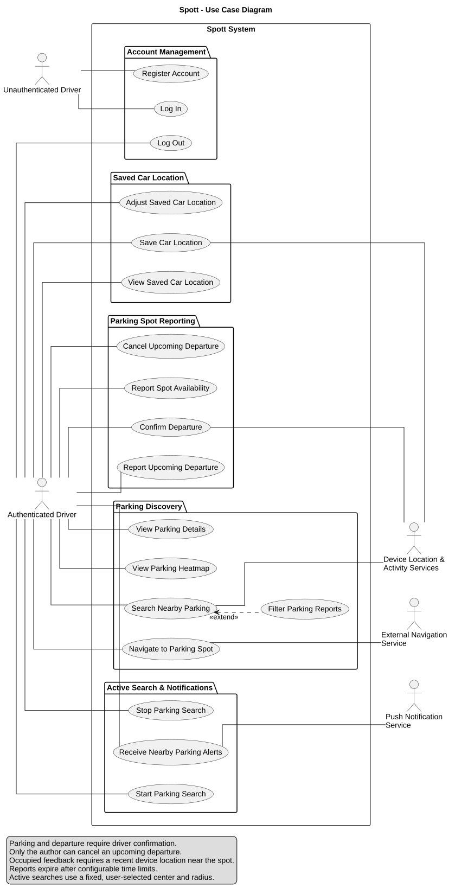

# Spott use cases

[PlantUML source](use-cases.puml) | [SVG preview](use-cases.svg)



This model covers the features in the [project overview](../../README.md), including the planned next iteration. Automatic parking detection, photos, heatmaps, and push alerts are planned features; their presence here does not move them into the MVP.

## Actors and boundary

The Spott boundary includes the Android app and its backend. Device location/activity services, the navigation provider, and the push delivery provider exchange information with Spott from outside that boundary.

- **Unauthenticated Driver:** someone creating an account or logging in, including an existing account holder whose session has ended.
- **Authenticated Driver:** someone with an active session using the parking features. This is the same person in a different session state; it is not a subtype of the unauthenticated role.
- **Device Location & Activity Services:** supply location and activity signals for saved-car detection, nearby discovery, and alerts.
- **External Navigation Service:** receives a destination from Spott and provides route guidance.
- **Push Notification Service:** delivers alerts requested by the Spott backend.

Authentication is a precondition for parking features in this model, following the original diagram. Guest parking discovery would require an explicit product decision.

## Use-case descriptions

Each row describes the trigger and observable result. Alternative flows preserve the functionality consolidated from the original diagram.

| Use case | Trigger and successful result | Alternatives and conditions |
| --- | --- | --- |
| Register Account | An unauthenticated driver requests an account; Spott creates it. | Duplicate or invalid details leave the account uncreated and show a correction message. |
| Log In | An account holder submits credentials; Spott establishes a session. | Failed authentication leaves the driver signed out. |
| Log Out | An authenticated driver ends their session. | Parking operations subsequently require authentication. |
| Save Car Location | The driver saves a parking position, or enabled device signals suggest parking; Spott records a car location the driver can retrieve. | Manual saving remains available. An automatic suggestion can be confirmed, corrected, or dismissed. Without usable location data, the driver selects a position manually. |
| View Saved Car Location | The driver requests their parked-car position; Spott displays the saved position. | If none exists, Spott explains that a location must first be saved. |
| Adjust Saved Car Location | The driver corrects an existing saved position; subsequent retrieval shows the correction. | Requires a saved position. Cancelling preserves the existing position. |
| Report Upcoming Departure | The driver reports that they expect to leave, using a saved or manually selected position; Spott publishes an upcoming-departure report. | A return-to-car prompt can initiate the same interaction. A photo is optional. The report does not guarantee availability. |
| Confirm Departure | The driver confirms leaving a previously reported position; Spott marks the report recently vacated with a timestamp. | Requires the driver's active departure report. Sufficient device evidence may provide an automatic confirmation path, as proposed in the overview. |
| Attach Parking Photo | During departure reporting, the driver chooses a photo; Spott attaches it to the report. | The report can be submitted without a photo. A failed upload permits retry or submission without the photo. |
| Report Spot Availability | The driver reports an observed spot as available or occupied; Spott reflects that observation in the report. | Requires an identifiable reported spot. This is feedback, not a reservation. |
| Search Nearby Parking | The driver requests nearby reports; Spott displays matching reports on a map with their status and age. | Uses current location when permitted and available; manual area selection provides an alternative. Empty results are a valid outcome. |
| Filter Parking Reports | While reviewing search results, the driver supplies distance or freshness criteria; Spott displays the matching subset. | Optional. An unfiltered search can complete independently; an empty filtered result is valid. |
| View Parking Details | The driver selects a report; Spott displays its location, status, timestamp, and available supporting information. | A report may expire or change while being viewed. |
| View Parking Heatmap | The driver requests a heatmap; Spott displays aggregated parking activity for the selected area. | Requires sufficient observations. Sparse data produces an insufficient-data message. |
| Navigate to Parking Spot | The driver chooses a reported destination; Spott opens the external navigation service with that location. | Requires a selected destination, rather than a fresh execution of View Parking Details. If the service is unavailable, Spott reports the failed handoff. |
| Start Parking Search | The driver enables an active search for an area and radius; Spott activates the search subscription. | Foreground map browsing remains independent. If notification permission is unavailable, Spott explains the limitation before enabling push alerts. |
| Receive Nearby Parking Alerts | A qualifying new or updated report matches an active search; Spott requests delivery of a nearby-parking alert to the driver. | Requires an active search, usable search-area/location information, and notification permission. Delivery may be delayed or fail; the map remains available. |
| Stop Parking Search | The driver stops an active search; Spott deactivates its subscription. | Subsequent matching reports do not generate new alerts for that search. Already dispatched messages may still arrive. |

Location selection, GPS lookup, map display, and report-status persistence belong inside these interactions. Report expiration is a lifecycle rule. They do not need separate use-case ellipses to remain requirements.

## Relationships

Solid, undirected associations show participation. They do not indicate who initiates an interaction or when it happens; the descriptions above supply that information. In particular, the driver receives alerts triggered by qualifying reports.

Only two optional extensions remain:

| Extension | Base use case | Extension point | Condition |
| --- | --- | --- | --- |
| Attach Parking Photo | Report Upcoming Departure | Before submitting the departure report | The driver chooses to attach a photo. |
| Filter Parking Reports | Search Nearby Parking | When reviewing search results | The driver chooses filtering criteria. |

The dashed `<<extend>>` arrow points from the extension to its base. Both bases can complete without their extensions. There are no `<<include>>` relationships in this version: the original candidates were internal steps or temporal prerequisites, and extracting them did not improve this view.

Adjusting a saved location is an independent goal with an existing-location precondition. Navigation requires a selected destination. Receiving alerts requires an already active search. None of those conditions means that another use case executes as an included behavior.

## Updating the preview

Edit `use-cases.puml`, then regenerate the SVG from the repository root with a Java runtime supported by your PlantUML release:

```sh
java -jar path/to/plantuml.jar -tsvg docs/uml/use-cases.puml
```

The current preview was rendered with PlantUML 1.2026.9. Hidden links in the source control placement only; they add no functional relationships. Folder-style packages keep functional-group headings away from connector routes; this is a visual adjustment to the skill's suggested rectangle style.

## Modeling references

- [UML use-case diagram skill](https://github.com/jonatan8254/iconix-uml-skills/blob/main/skills/uml-use-case-diagram/SKILL.md): review checklist for actor goals, scope, granularity, and relationship restraint. Applied as guidance for this refactor.
- [OMG UML 2.5.1](https://www.omg.org/spec/UML/2.5.1): specification reference for use-case notation and semantics.
- [PlantUML use-case documentation](https://plantuml.com/use-case-diagram): source syntax for actors, use cases, boundaries, and associations.
- [IBM include guidance](https://www.ibm.com/docs/en/rsas/7.5.0?topic=diagrams-include-relationships) and [extend guidance](https://www.ibm.com/docs/en/dma?topic=diagrams-extend-relationships): behavior reuse and conditional extensions at defined extension points.
- [IBM use-case specification outline](https://www.ibm.com/docs/en/engineering-lifecycle-management-suite/doors-next/7.2.0?topic=cases-use-case-specification-outline): textual flows, preconditions, postconditions, and extension points.

The skill is community guidance; it does not certify a model. The descriptions above record the product assumptions that should be reviewed as requirements evolve.
